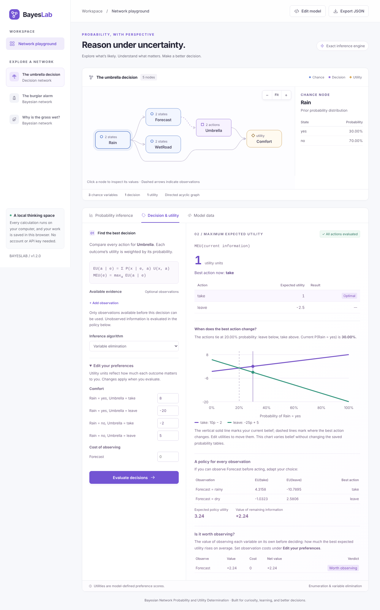

# BayesLab: Bayesian Network Probability and Utility Determination

Hi there! 👋

I'm **Neeraj Yadav**, a master's student in Computer Science at the University of Kansas. My coursework and projects span deep reinforcement learning, HPC job scheduling, and applied machine learning. This repository is my project **BayesLab**. In this README I'll walk you through what it does, how it works, and how I checked that its answers are right.

**Try it live:** [bayeslab.onrender.com](https://bayeslab.onrender.com). It runs on a free server that sleeps when nobody is using it, so the first visit can take about a minute to wake it up.



## What BayesLab is

When you have to decide something under uncertainty, there are really two separate questions:

1. **What is likely to happen?** BayesLab answers this with a discrete **Bayesian network**: a set of variables, arrows showing which ones depend on which, and a probability table for each one.
2. **What is the best thing to do about it?** It answers this with **expected utility**: each action is scored by how much every possible outcome matters to you, weighted by how likely that outcome is.

I built BayesLab to put both in one place. You can ask it exact probability questions, compare actions, find out which observation is worth paying for before you decide, and build your own networks, all in the browser and with every step of the calculation shown. Everything is calculated exactly (no sampling or approximation) in plain Python, without any third-party packages.

My running example is a small umbrella decision: should you take an umbrella, given a weather forecast? The probabilities and preferences in it are made-up teaching values, not real weather data.

## Try it on your computer

You need **Python 3.10 or newer**. The engine, the browser app, the demo, and the core tests use only Python's standard library, so there's nothing to install: no build step, account, API key, or database.

```bash
python3 app.py
# or: python3 -m bayesnet
```

Then open [http://127.0.0.1:8000](http://127.0.0.1:8000). Stop it with `Ctrl+C`. If port 8000 is already taken:

```bash
python3 -m bayesnet serve --port 8765
```

On Windows, use `python` or `py` instead of `python3`. Each calculation stops after 60 seconds by default (`--time-limit SECONDS`, or `0` for no limit).

To run the worked example or the tests:

```bash
python3 bayesian_decision_starter.py
python3 bayesian_decision_starter.py --self-test
# the same tests: python3 -m unittest discover -v
```

## What you can do with it

- Ask for **joint probabilities**, single-variable **marginals**, joint events over a few variables, and **conditional probabilities** given what you've observed.
- Pick one of two exact algorithms, **enumeration** or **variable elimination**, and open a step-by-step trace of how the answer was calculated.
- See all eight possible "worlds" of the umbrella model and which ones match your question.
- Compare the **expected utility** of every action, get the **maximum expected utility**, and see every action that ties for best.
- Get a full **policy** (what to do for every possible observation), the **value of information**, and **which single observation is worth paying for**, with optional **observation costs**.
- Change your preferences and watch the recommendation and the **sensitivity chart** update, for **any number of actions**.
- **Build a network visually**: add variables, decisions, and utilities, pick parents from a list that won't let you create a cycle, and fill in probability tables with live row totals and one-click normalizing. The diagram previews your draft before you apply it.
- Pan and zoom the network diagram. Bigger networks are laid out in layers, so arrows don't run through nodes.
- Close the tab and come back later: your model, your queries, and unapplied edits are kept in your browser.
- Inspect any node, and edit, validate, import, or export models as JSON.
- Use the same engine from Python, the command line, or a JSON API.

All the maths runs in Python. The browser only draws the results and handles the forms.

## The umbrella example, step by step

Here's the model I use to explain everything. It has rain, a weather forecast, and wet roads, and it recommends whether to take an umbrella based on the forecast and a table of preferences.

| Variable | Role | States / meaning |
| --- | --- | --- |
| `Rain` | Chance | `yes`, `no` |
| `Forecast` | Chance; known before deciding | `rainy`, `dry` |
| `WetRoad` | Chance; used to show probability queries | `yes`, `no` |
| `Umbrella` | Decision | `take`, `leave` |
| `Comfort` | Utility | A numeric score, not a probability |

State names are **case-sensitive**, and I use lowercase labels in all the bundled examples.

```text
Chance graph:                   Decision extension:
        Rain                    Forecast - - information - -> Umbrella
       /    \                   Rain -----------------------> Comfort
      v      v                  Umbrella -------------------> Comfort
  Forecast  WetRoad
```

The chance graph factorizes as:

```text
P(Rain, Forecast, WetRoad)
  = P(Rain) × P(Forecast | Rain) × P(WetRoad | Rain)
```

So Forecast and WetRoad are independent once you know whether it rains. The arrows describe how the probabilities factor; they don't claim that tomorrow's rain causes today's forecast. Taking an umbrella doesn't change the weather either. Only the forecast is known before you decide: probability queries can use WetRoad, but decision analysis refuses it because you can't see the road before you choose.

### Probability tables

| Rain | Prior |
| --- | ---: |
| yes | 0.30 |
| no | 0.70 |

| Rain | P(Forecast=rainy) | P(Forecast=dry) | P(WetRoad=yes) | P(WetRoad=no) |
| --- | ---: | ---: | ---: | ---: |
| yes | 0.80 | 0.20 | 0.90 | 0.10 |
| no | 0.20 | 0.80 | 0.10 | 0.90 |

Forecast and WetRoad are **separate conditional distributions**: each pair of columns adds up to one for each rain state, but all four columns together don't.

### Preferences

| Action | Rain=yes | Rain=no |
| --- | ---: | ---: |
| take | +8 | −2 |
| leave | −20 | +5 |

Utilities are preference scores, not percentages, so they don't need to add up to one. Changing them can change the best action without changing the predicted weather.

### Working it out by hand

| Rain | Forecast | WetRoad | Joint probability |
| --- | --- | --- | ---: |
| yes | rainy | yes | 0.216 |
| yes | rainy | no | 0.024 |
| yes | dry | yes | 0.054 |
| yes | dry | no | 0.006 |
| no | rainy | yes | 0.014 |
| no | rainy | no | 0.126 |
| no | dry | yes | 0.056 |
| no | dry | no | 0.504 |
| | | **Total** | **1.000** |

```text
P(R=yes, F=rainy, W=yes) = 0.30 × 0.80 × 0.90 = 0.216
P(F=rainy) = 0.216 + 0.024 + 0.014 + 0.126 = 0.38
P(W=yes) = 0.216 + 0.054 + 0.014 + 0.056 = 0.34
P(R=yes | F=rainy) = (0.216 + 0.024) / 0.38 = 12/19
```

In that last query WetRoad is unknown, so it's summed out rather than assumed dry.

| Forecast | Probability of rain | EU(take) | EU(leave) | Best action / MEU |
| --- | ---: | ---: | ---: | --- |
| rainy | 63.157895% | 4.315789 | −10.789474 | take / 4.315789 |
| dry | 9.677419% | −1.032258 | 2.580645 | leave / 2.580645 |

If the probability of rain is `p`, then `EU(take) = 10p − 2` and `EU(leave) = 5 − 25p`. Taking the umbrella is better above **20%**, and at exactly 20% the two actions tie. That's the key idea: choosing based on the most likely weather is not the same as choosing the action with the highest expected utility.

Before you see the forecast, taking the umbrella has EU `1`, leaving it has EU `−2.5`, so the MEU is `1`. If you wait for the forecast and act on it, your expected utility becomes `0.38 × 4.315789… + 0.62 × 2.580645… = 3.24`. So the forecast is worth `3.24 − 1 = 2.24` utility units, assuming it's free. If it cost 3 units, its net value would be `2.24 − 3 = −0.76`, and it wouldn't be worth buying.

## Using the app

1. Open **The umbrella decision**. The first query is the probability of rain given a rainy forecast.
2. Choose **Marginal**, **Joint**, or **Conditional**, then pick states and observations. Any variable you don't select is summed out.
3. Pick an inference algorithm and click **Calculate probability**. Expand the calculation trace, or inspect all possible worlds.
4. Open **Decision & utility**. It starts with a rainy forecast as evidence. Change it to dry, or remove it to see the decision before you observe anything.
5. Change values under **Edit your preferences** (utilities and, optionally, what each observation costs), then click **Evaluate decisions**. The sensitivity chart plots expected utility against the probability of rain: the solid line marks your current belief, and dashed lines mark where the best action changes.
6. Click **Compare every possible forecast / observation** to see the full policy and the **Is it worth observing?** table.
7. In **Model data**, use the **Visual builder** (or the **JSON** view, or **Import** a file), then **Validate & apply**. **Discard changes** takes you back to the applied model, and **Export JSON** saves it.
8. Use **−**, **Fit**, and **+** above the diagram to zoom. Drag to pan, or hold Ctrl/⌘ while scrolling to zoom around the pointer.

Your work is saved in your browser automatically, including unapplied builder and JSON drafts, and it comes back when you reopen BayesLab, even if the server happens to be busy at that moment. It only leaves your browser to be calculated, and other browsers or devices don't see it. Picking a bundled example restores its original model. Utility and cost edits only take effect after a successful evaluation, and unapplied drafts aren't included in exports.

### Building your own network

In **Model data → Visual builder** you can add chance variables, one decision, and utilities. For the selected node you can rename it, edit its states (2 to 8), and tick its parents. Choices that would create a cycle are disabled, with a note explaining why. Adding a parent copies the existing probabilities into every new row, so nothing changes until you edit it. Each row of a probability table shows its total in green when it adds up to 1 and in red when it doesn't, and **Normalize** rescales a row for you. A decision lists what it observes before acting and what each observation costs. The node list flags tables that still need attention, and the Python engine validates everything when you apply. If an imported model is missing table rows, the builder fills them in (uniform probabilities, or utility 0), tells you, and highlights them until you edit or normalize them; the JSON view and the engine reject incomplete tables outright.

The sensitivity chart needs a binary outcome, actions that don't change any chance probabilities, and utilities that depend only on that outcome and the decision. It works for any number of actions and follows the best one across the whole probability range. It varies your belief while keeping the utilities fixed, so editing utilities moves the crossover points. Custom models that don't fit these conditions still get full probability and decision analysis; only this one chart is skipped.

## How it works under the hood

I implemented two exact inference algorithms so they can check each other.

**Enumeration** walks depth first through the complete "worlds", assigning variables in topological order like the textbook ENUMERATION-ASK, so each probability table entry is multiplied in once and shared by every world below it. Observed variables only take their observed state, and a branch is dropped as soon as its probability hits zero. A conditional query divides the probability of event-and-evidence by the probability of the evidence. It still grows with the number of worlds that match the evidence (binary networks have 2ⁿ worlds), but it's about 10–20 times faster than visiting every world separately. Its size limit only counts worlds that match the evidence, so a 24-node network with 23 observed variables is fine even though it has 16.7 million worlds in total. For decisions, enumeration walks the worlds once (once per action if the action changes a probability table) and adds up each observation branch's probability and utility-weighted probability, so a whole policy costs about as much as a single expected utility.

**Variable elimination** turns the probability tables into factors. It first prunes "barren" variables: ones that are neither asked about nor observed and have no asked-about or observed descendants, because summing them out just multiplies the answer by one. The calculation trace lists what was pruned. Then it applies the evidence, multiplies the factors that mention each hidden variable, and sums that variable out, choosing the order greedily so the intermediate factors stay as small as possible. The factor operations are `restrict`, `multiply`, `sum_out`, and `normalize`. A query about one variable keeps the whole distribution; a query about several variables uses two scalar eliminations to avoid building a large table. For policies, I run one elimination per action and utility over the unobserved information and that utility's inputs, and read every observation branch off that shared result, instead of one elimination per branch, action, and utility. That made a 512-row test policy about 5× faster (measurements below). Branches less likely than 1e-250, and factors too large to share, are recalculated one branch at a time.

**Value of each observation.** Besides the value of observing all remaining information, BayesLab reports the value of observing each variable on its own, and its net value after the observation's cost. Two variables can each be worthless alone yet valuable together (the tests include an XOR example like that), so the per-variable values don't add up to the joint value.

**Sensitivity.** With a binary outcome, each action's expected utility is a straight line in that outcome's probability. The best action follows the upper envelope of those lines, so BayesLab reports every interval with its best actions and every threshold where the best action changes, however many actions there are.

**Time limits.** Exact inference can take exponential time in the worst case, so long calculations check a clock and stop with `ComputationTimeout` (a `ModelError`) instead of running forever. The server allows 60 seconds per calculation by default and 10 seconds in public mode; in Python you opt in with `with time_limit(seconds):`.

**Very small probabilities.** A float can't hold numbers below about 1e-308, so very unlikely evidence would round down to zero in ordinary arithmetic. Enumeration rescales tiny products by exact powers of two and keeps track of the exponent. Elimination runs on ordinary floats, notices any product that would underflow, and then redoes the work with every value stored as a mantissa plus its own exponent. That keeps posteriors and expected utilities accurate even when the evidence probability is far below 1e-308, and `ImpossibleEvidence` is only raised when the evidence truly has probability zero. Such an evidence probability shows up as `0.0` in `evidence_probability`, with its exact size in `log10_evidence_probability`.

The formulas behind it:

```text
P(event | evidence) = P(event, evidence) / P(evidence)
EU(a | e) = Σ_x P(x | e, do(D=a)) U(x,a)
MEU(e) = max_a EU(a | e)
π*(i,e) = argmax_a EU(a | i,e)
PolicyEU(e) = Σ_i P(i | e) max_a EU(a | i,e)
ValueOfInformation(e) = PolicyEU(e) − MEU(e)
VOI(X | e) = Σ_x P(x | e) max_a EU(a | e, x) − MEU(e)
NetVOI(X | e) = VOI(X | e) − cost(X)
```

Here `do(D=a)` means fixing a decision you control in the model; it doesn't estimate causal effects from observational data. Inference is always exact, but its cost grows with the largest intermediate factor, so variable elimination isn't guaranteed to be fast on every graph.

## How I checked that it's right

I didn't want to just trust my own code, so I compare it against [pgmpy](https://pgmpy.org/), an independent Python library. My optional adapter builds pgmpy's [DiscreteBayesianNetwork](https://pgmpy.org/api/generated/models/pgmpy.models.DiscreteBayesianNetwork.html) with named states, runs `check_model()`, and answers queries with its own [VariableElimination](https://pgmpy.org/api/generated/inference/pgmpy.inference.VariableElimination.html). A decision is fixed directly in the affected tables instead of being turned into a random node, and pgmpy never calls my algorithms.

To reproduce it:

```bash
python3 -m venv .venv
.venv/bin/python -m pip install -r requirements-reference.txt
.venv/bin/python -m unittest discover -v
.venv/bin/python -m experiments.compare_inference --output docs/benchmark.json
```

On Windows use `.venv\Scripts\python.exe`. Without the optional packages:

```bash
python3 -m experiments.compare_inference --without-pgmpy
```

The test suite has **80 tests**, and they all pass with pgmpy and Playwright installed. The comparison checks **278 probability queries** across all three bundled models, including every disjoint event/evidence combination in the umbrella model, plus all four forecast/action expected utilities. The largest disagreement with pgmpy was **2.22 × 10⁻¹⁶**, which is floating-point rounding. A normal test run skips the two pgmpy checks and the thirteen browser tests when those optional packages aren't installed, and says so.

I also wrote a second check that compares everything against exact fractions on random networks, using an "oracle" that shares no code with the engines:

```bash
python3 -m experiments.random_oracle --networks 1500
```

On 1,500 random networks (2–3 states per variable, up to two parents, zero probabilities, decisions that change chance probabilities, several utilities, and observation costs), it made 36,000 probability checks and 7,688 decision analyses with both methods, covering expected utilities, ties, policies, and joint and per-variable value of information, plus 400 sensitivity checks with 2–6 actions. It found **no disagreements**.

Here are median query times from [my recorded results](docs/benchmark.json): Python 3.10.12 in a Linux ARM64 virtual machine on my Mac, pgmpy 1.1.2, 25 timed repetitions after a warm-up.

| Binary-chain nodes | Possible worlds | Enumeration | My elimination | pgmpy reference |
| ---: | ---: | ---: | ---: | ---: |
| 4 | 16 | 0.023 ms | 0.046 ms | 0.240 ms |
| 8 | 256 | 0.136 ms | 0.122 ms | 0.352 ms |
| 12 | 4,096 | 1.762 ms | 0.224 ms | 0.483 ms |
| 16 | 65,536 | 28.037 ms | 0.338 ms | 0.633 ms |

These numbers are from my machine, not a general speed guarantee. Chains have small intermediate factors, so they favour elimination, while enumeration still doubles with every node added (the evidence `X0 = yes` halves the worlds it visits). Imports and model construction aren't timed; query validation and the reference adapter's impossible-evidence checks are. Results depend on the network's shape, the implementation, the hardware, and the elimination order. On the same machine, a 25-node network with an 8-action decision, three utilities, and a 512-row policy takes 0.64 s with variable elimination, down from 3.42 s before policies shared factors.

The tests also cover: total joint probability equal to one, the hand calculations above, random queries against a separate checker, variables with more than two states, invalid models, impossible evidence, actions that change outcomes, several utilities added together, ties at very small and very large utility scales, sensitivity with two and three actions, pruning, single-pass and shared-factor policies, per-variable value of information and costs, time limits, the enumeration size limit, public-mode settings, evidence far less likely than 1e-308 (checked against exact fractions), and the HTTP routes, including JSON replies to broken or failing requests.

The [browser tests](tests/test_browser.py) drive the real interface in headless Chromium:

- queries with both algorithms, and the joint table;
- decisions with costs and edited preferences, and a three-action sensitivity chart;
- building a network in the visual builder, and a single click right after editing a field;
- imported text that must never be treated as HTML, and missing table rows being flagged;
- JSON errors and discarding drafts;
- a saved session surviving a reload and a busy server;
- deleting every node, diagram zoom, and the phone layout.

To run them:

```bash
python3 -m pip install playwright && python3 -m playwright install chromium && python3 -m unittest tests.test_browser -v
```

## Using it from Python, the command line, or the API

### Python

```python
from bayesnet import Network, Enumeration, Inference, DecisionAnalysis
from bayesnet.examples import load_example

network = Network(load_example("umbrella"))
engine = Enumeration(network)  # Inference(network) uses variable elimination

engine.joint_probability({"Rain": "yes", "Forecast": "rainy", "WetRoad": "yes"})
# 0.216; a complete joint assignment must give every chance variable

engine.event_probability({"Forecast": "rainy"})  # 0.38
engine.event_probability({"Rain": "yes", "Forecast": "rainy"})  # 0.24
engine.conditional_probability({"Rain": "yes"}, {"Forecast": "rainy"})  # 12/19
engine.distribution("Rain", {"Forecast": "rainy"})
# {"yes": 0.631578947368421, "no": 0.368421052631579}

worlds = list(Enumeration(network).worlds())
trace = engine.query({"Rain": "yes"}, {"Forecast": "rainy"})

analysis = DecisionAnalysis(network)  # method="enumeration" also works
analysis.expected_utility("take", {"Forecast": "rainy"})["expected_utility"]
# 4.315789473684211
analysis.analyze({"Forecast": "rainy"})["best_action"]  # "take"
analysis.analyze()["policy_expected_utility"]  # 3.24
analysis.analyze()["information_values"]
# [{"variable": "Forecast", "value": 2.24, "cost": 0.0, "net_value": 2.24, "worth_observing": True}]
analysis.sensitivity("Rain")["threshold"]  # 0.2 (see "thresholds" and "regions" for 3+ actions)

from bayesnet import time_limit, ComputationTimeout
with time_limit(5):  # raises ComputationTimeout if a calculation runs longer than 5 seconds
    engine.probability({"Rain": "yes"}, {"WetRoad": "yes"})
```

Umbrella probability queries don't need an action, because the umbrella can't change the weather. For a model where a decision is a parent of a chance variable, pass `action=...`. Decision analysis uses each action's own outcome distribution rather than reusing one posterior for all actions.

### Command line

```bash
python3 -m bayesnet query --example umbrella --event Forecast=rainy
python3 -m bayesnet query --example umbrella --event Rain=yes Forecast=rainy WetRoad=yes
python3 -m bayesnet query --example umbrella --event Rain=yes --evidence Forecast=rainy --method enumeration
python3 -m bayesnet utility --example umbrella --evidence Forecast=dry
python3 -m bayesnet utility --example umbrella
python3 -m bayesnet validate --model bayesnet/examples/umbrella.json
```

The analysis commands print JSON. Invalid input gets an explanation and a nonzero exit code. Installing with `python3 -m pip install .` adds a `bayeslab` command.

### Model files

[The umbrella model](bayesnet/examples/umbrella.json) is the reference configuration. The [alarm](bayesnet/examples/alarm.json) and [sprinkler](bayesnet/examples/sprinkler.json) examples show other graphs, including variables with several parents.

```json
{
  "name": "Small example",
  "chance_nodes": [
    {"name": "Rain", "states": ["yes", "no"], "parents": [],
     "cpt": [{"when": {}, "probabilities": {"yes": 0.3, "no": 0.7}}]}
  ],
  "decision_nodes": [
    {"name": "Umbrella", "states": ["take", "leave"], "information": []}
  ],
  "utility_nodes": [
    {"name": "Comfort", "parents": ["Rain", "Umbrella"], "table": [
      {"when": {"Rain": "yes", "Umbrella": "take"}, "value": 8},
      {"when": {"Rain": "no", "Umbrella": "take"}, "value": -2},
      {"when": {"Rain": "yes", "Umbrella": "leave"}, "value": -20},
      {"when": {"Rain": "no", "Umbrella": "leave"}, "value": 5}
    ]}
  ]
}
```

A decision that observes something before acting lists it under `information`, and can give the cost of each observation in utility units (anything not listed is free):

```json
{"name": "Umbrella", "states": ["take", "leave"], "information": ["Forecast"],
 "observation_costs": {"Forecast": 0.5}}
```

Validation rejects:

- duplicate names, undefined parents, and cycles (including through information arcs);
- invalid states, missing or duplicate parent assignments, and missing child probabilities;
- values that aren't finite numbers, and probabilities outside 0–1;
- probability rows that don't add up to one (within `1e-9`);
- utilities whose largest possible total exceeds `1e300`, so no sum can overflow;
- observation costs that are negative, or that name a variable outside the information set.

Error messages name the variable, the table row, and the value at fault. Utilities can be negative, and several utility nodes add together. A decision has actions and an information set, not a probability distribution, and utility nodes can't have children.

Queries with unknown variables or states are rejected. If the event contradicts possible evidence, the answer is simply zero. Evidence with probability zero raises `ImpossibleEvidence` rather than producing a made-up posterior, and unreachable policy branches are labelled as such.

Ties are judged relative to the model's utility scale: two expected utilities tie when they differ by at most `1e-12 × Σ max|U|`, the largest absolute total utility any outcome can produce. Because the tolerance scales with the utilities, the units you write them in don't change which actions tie. The same tolerance turns rounding noise in the value of information into exactly zero, since observing more can never lower expected utility. All optimal actions are reported, and the first one declared is used as a consistent tie-break in a policy.

### JSON API

Every POST request includes `"model": {...}`. Invalid requests get HTTP 400 with `{"error": "..."}` explaining the problem in plain words (for example the line and column of a JSON syntax error), and so do calculations stopped by the time limit. If every calculation slot stays busy for 5 seconds, the server answers 503 with a `Retry-After` header. An unexpected server fault returns HTTP 500 in the same format and prints details in the terminal running BayesLab, so every request gets a JSON reply. Request bodies are limited to 1 MB.

| Method | Endpoint | Extra fields / result |
| --- | --- | --- |
| GET | `/healthz` | `{"status": "ok"}` for hosting health checks |
| GET | `/api/config` | Version, whether the server is public, and its time limit |
| GET | `/api/examples` | Example metadata |
| GET | `/api/examples/umbrella` | JSON model; also `alarm`, `sprinkler` |
| POST | `/api/validate` | Summary of the validated model |
| POST | `/api/query` | `event`, optional `evidence`, `action`, `method`; probability, distribution, trace, evidence probability and its `log10` |
| POST | `/api/worlds` | Optional `action`; the complete joint table, up to 256 worlds |
| POST | `/api/utility` | Optional `evidence`, `method`; EU, MEU, ties, policy, value of information, `information_values` per variable, `observation_cost`, `net_value_of_information` |
| POST | `/api/sensitivity` | `target`, optional `evidence`; utility lines, posterior, `threshold`, `thresholds`, `regions`, sampled points |

`method` is `elimination` (default) or `enumeration`. Decision evidence must be in the declared information set. `action` is only needed for probability and world queries when a decision changes a chance variable's table.

## How I host it for free

The live version at [bayeslab.onrender.com](https://bayeslab.onrender.com) runs on Render's free plan. Because BayesLab only needs Python's standard library, any host that runs Python can serve it. Public mode listens on every network interface and on the port the host provides in the `PORT` environment variable. It also limits each calculation to 10 seconds, runs at most two calculations at a time, and disconnects clients that stall while sending a request. The server stores nothing, and the sidebar tells visitors that their work stays in their own browser.

```bash
python3 -m bayesnet serve --public            # what the host runs
BAYESLAB_PUBLIC=1 PORT=10000 python3 app.py    # the same, set through environment variables
```

| Setting | Command-line option | Environment variable | Default |
| --- | --- | --- | --- |
| Public mode | `--public` | `BAYESLAB_PUBLIC=1` | off |
| Address | `--host` | `BAYESLAB_HOST` | `127.0.0.1`, or `0.0.0.0` in public mode |
| Port | `--port` | `PORT` | `8000` |
| Seconds per calculation | `--time-limit` | `BAYESLAB_TIME_LIMIT` | 60, or 10 in public mode (`0` means none) |

**To deploy your own copy on Render:**

1. Fork [this repository](https://github.com/neerajydv0908/bayeslab) on GitHub.
2. In the [Render dashboard](https://dashboard.render.com), choose **New → Blueprint** and select your fork. [`render.yaml`](render.yaml) already describes a free Python web service that runs `python -m bayesnet serve --public` with the `/healthz` health check.
3. Open the `onrender.com` address Render gives you.

According to [Render's free-plan documentation](https://render.com/docs/free), free web services spin down after 15 minutes without traffic and take about a minute to wake up on the next visit, and each workspace gets 750 free instance hours per month. Other hosts that read a `Procfile` (`web: python -m bayesnet serve --public`) work the same way. The [GitHub Actions workflow](.github/workflows/tests.yml) runs the tests on Python 3.10–3.13, the pgmpy comparison, and the browser tests on every push.

## Project layout

```text
app.py                         Browser-app entry point
bayesian_decision_starter.py    Worked demo and --self-test
bayesnet/
  model.py                     Model / graph / table / query validation
  enumeration.py               Exact inference by visiting complete worlds
  inference.py                 Factors and exact variable elimination
  decision.py                  EU, MEU, policies, information values, sensitivity
  limits.py                    Optional time limits for long calculations
  reference.py                 Optional pgmpy adapter
  examples.py                  Model loader
  examples/*.json              Umbrella, alarm, and sprinkler models
  server.py                    HTTP server (local or public mode) and JSON endpoints
  __main__.py                  Command-line interface
  web/app.js                   Browser UI, layered SVG diagram, charts, saved sessions
  web/builder.js               Visual model builder
experiments/compare_inference.py  Correctness and timing check against pgmpy
experiments/random_oracle.py   Random networks checked against exact fractions
tests/                         Probability, decision, validation, API, upgrade and browser tests
docs/benchmark.json            Recorded, reproducible results
render.yaml, Procfile          Free hosting configuration
.github/workflows/tests.yml    Automated tests on every push
requirements.txt               Documents that the app needs no packages
requirements-reference.txt     Pinned optional pgmpy dependency
pyproject.toml                 Optional package and command installation
```

## Limits, and what I'd like to add next

This version supports discrete networks (directed acyclic graphs) with up to 30 nodes in total, 2–8 states per variable, one decision, and several additive utilities. It caps factors at 200,000 entries, tables at 25,000 parent combinations, enumeration at 1,048,576 worlds that match the evidence, policies at 512 observation combinations, and each server calculation at 60 seconds (10 in public mode). A problem that's too large gets a clear error instead of a silent approximation. Probabilities below the float range are handled by exact rescaling, as described above. The visual builder shows the first 400 rows of a very large table; you can edit the rest in the JSON view.

What I'd like to add next:

- **Several decisions in sequence** (influence diagrams with no-forgetting policies), where later decisions can see earlier actions and outcomes.
- **Learning probability tables from data**: estimate the tables on training data only, use validation data for model choices, and evaluate once on held-out data with log loss, Brier score, and realized policy utility. Recovering probabilities from simulated data would only validate that simulation, not real-world forecast accuracy.
- **Approximate inference** (likelihood weighting or Gibbs sampling, with the uncertainty reported) for networks beyond the exact limits.
- **Continuous variables**, for example by splitting them into intervals.

Real weather prediction is outside the scope of this teaching model.

## Thanks for reading!

If you try BayesLab and spot something odd, or have an idea for it, feel free to [open an issue](https://github.com/neerajydv0908/bayeslab/issues). I'd love to hear what you think.

— Neeraj
